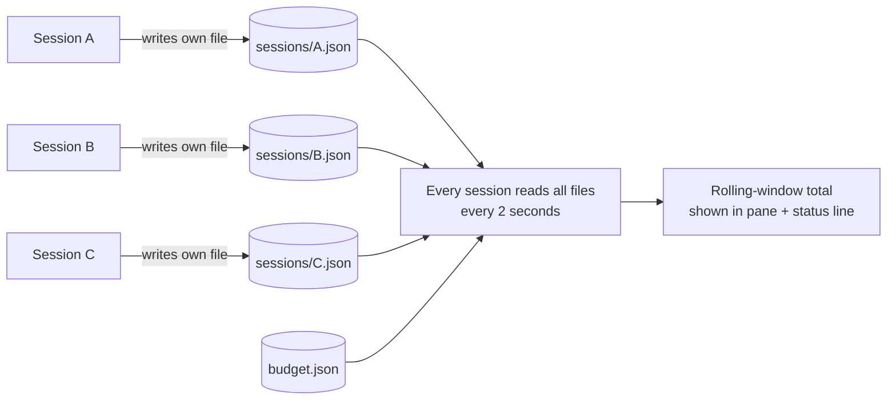

<div align="center">

# 📟 claude-token-meter

### See your Claude Code token usage *live*, while Claude is still typing.

A Claude Code plugin with a live usage pane, a status line, budgets that warn you **before** you overspend,<br>
a shared total across **every** session on your machine, and a built-in cost calculator.

<br>

[](LICENSE)
[](https://github.com/tanmayhc7/claude-token-meter)
[](hooks/register.tsx)
[](.claude-plugin/plugin.json)

[**Install**](#-install) · [**Features**](#-features) · [**Commands**](#-commands) · [**How it works**](#-how-the-all-sessions-total-works) · [**Development**](#-development)

</div>

---

## ✨ Features

<table>
<tr>
<td width="50%" valign="top">

### 📊 Live usage pane
A **Token usage** pane beside the chat. Reopen it any time with `/tokens`.

- Input split into **uncached**, **cache read** and **cache write**
- Output tokens, with a **live estimate** while a response streams
- Total tokens, request count, and session cost
- Context-window bar: 🟢 → 🟡 at 60% → 🔴 at 85%
- A progress bar for every budget you set

</td>
<td width="50%" valign="top">

### 📟 Status line
The same numbers, on one line, always visible:

```text
in 182.4k · out 6.1k +~240 · Σ 188.5k/500.0k
· ctx 18% · $0.42/$5.00
│ all 3.42M/5.00M · 1.58M left
```

Subagent requests are counted too.

</td>
</tr>
<tr>
<td width="50%" valign="top">

### 🚨 Budgets that warn early
Set a **token** budget, a **dollar** budget, or both. You get a pop-up and a system notification at **80%** and again at **100%**.

Session budgets carry over to later sessions until you clear them.

</td>
<td width="50%" valign="top">

### 🌐 All-sessions total
Every Claude Code session on your machine with token-meter installed feeds one shared ledger. Run three sessions at once and each shows the **same** "used / limit · left" figure, refreshed every **2 seconds**, including responses still streaming in the others.

</td>
</tr>
</table>

### 💸 Cost calculator
Price a request *before* you send it, on every model or just one, both with fresh input and with input read from the prompt cache.

```text
> /token-cost 200k 20k sonnet
```

---

## 🖥️ What the pane looks like

> Illustrative layout, based on what the plugin renders. Your numbers will differ.

```text
This session
Input          188.5k
  uncached       6.1k
  cache read   176.2k
  cache write    6.2k
Output           6.1k
All tokens     194.6k
Requests          23
Cost           $0.42
Context window
████░░░░░░░░░░░░░░░░ 18%
Session cost budget
████░░░░░░░░░░░░░░░░ 8%
$0.42 of $5.00 · $4.58 left

All sessions · last 5h
Sessions            3 (1 responding now)
All tokens      3.42M
Cost            ~$2.10 (list prices)
All-sessions token budget
█████████████░░░░░░░ 68%
3.42M of 5.00M · 1.58M left
```

Bars turn **yellow** at 80% and **red** at 100% of a budget.

---

## 🚀 Install

You need Claude Code installed and signed in. Pick either route.

**Inside Claude Code**

```text
/plugin install token-meter --marketplace tanmayhc7/claude-token-meter
```

1. Answer `y` when asked to add the `claude-token-meter` marketplace.
2. Pick a scope:

| Scope | Where it's on |
| :-- | :-- |
| **user** | Every project |
| **project** | Current folder only, shared through the repo's `.claude/settings.json` |
| **local** | Current folder only, just for you |

**From a shell**

```bash
claude plugin install token-meter --marketplace tanmayhc7/claude-token-meter
```

Then **start a new session**. Plugins load at session start, so an already-open session won't have it until restarted.

<details>
<summary>Verify or remove</summary>

Type `/plugin` and look for `token-meter` in the list. To remove it:

```bash
claude plugin uninstall token-meter
```

</details>

---

## 🖥️ Using it in the Claude desktop app

token-meter runs in the desktop app's **Code** tab, which is Claude Code. It doesn't run in the app's regular chat.

**Install it once, from a terminal.** The `/plugin` dialog only works in a terminal session, so use the shell command. Open the Terminal app (or the Terminal panel in the Code tab) and run:

```bash
claude plugin install token-meter --marketplace tanmayhc7/claude-token-meter
```

Pick the **user** scope so it's on in every project. The desktop app reads the same Claude Code settings as the terminal, so nothing else needs setting up.

**Then, in the desktop app:**

1. Open the **Code** tab and start a **new** session. A session that was already open won't load the plugin.
2. The **Token usage** pane opens beside the conversation. Closed it? Type `/tokens` in the prompt box.
3. Type the commands in the prompt box, the same as in a terminal: `/token-budget $5`, `/token-budget all 5M`, `/token-cost 200k 20k sonnet`. Start typing `/token` to see them in the suggestions.
4. Budget warnings show as a pop-up in the app and as a macOS notification, if notifications are allowed for Claude.

> [!TIP]
> Desktop and terminal sessions share one all-sessions total, so a session in the desktop app and one in your terminal both count toward `/token-budget all`.

<details>
<summary>Update or remove</summary>

Run in a terminal, then start a new session in the Code tab:

```bash
claude plugin update token-meter
```

```bash
claude plugin uninstall token-meter
```

</details>

---

## ⌨️ Commands

| Command | What it does |
| :-- | :-- |
| `/tokens` | Opens the token usage pane |
| `/token-budget 500k` | Sets a **token** budget for this session |
| `/token-budget $5` | Sets a **dollar** budget (both at once: `/token-budget 500k $5`) |
| `/token-budget` | Shows the current budgets |
| `/token-budget off` | Clears this session's budget |
| `/token-budget all 5M` | Budget shared by **every** session, over the last 5 hours |
| `/token-budget all $20 24h` | Shared dollar budget over another window (`5h`, `24h`, `7d`, …) |
| `/token-budget all off` | Clears the shared budget, in every session |
| `/token-cost 200k 20k` | Prices 200k input + 20k output on every model |
| `/token-cost 200k 20k opus` | Same, for one model (`opus`, `sonnet`, `haiku`, `fable`, or an id like `opus-4-8`) |

Brackets and `|` are ignored, so typing the hint as shown (`[500k]`) works too.

> [!NOTE]
> **How token budgets count.** Every request re-sends the whole conversation, and most of it comes from the prompt cache. Counting those cache reads in full would use up a 500k budget in two requests of a long conversation, so budgets count them **at their price weight**: fresh input, cache writes and output in full, cache reads at what they cost next to fresh input (1/20 on Opus 5.5, 1/10 on most models). The pane lists both: **All tokens** (everything, raw) and **Counted** (what the budget uses).

### 🧭 Quick tour

1. **Start a session.** The pane opens and the status line reads zero until Claude answers.
2. **Send a message.** The output figure counts up (`+~240` is the live estimate). When the response finishes, exact API counts replace it.
3. **Set a budget** if you want a warning: `/token-budget $5` or `/token-budget 500k`.
4. **Price a request** before sending: `/token-cost 200k 20k sonnet`.
5. **Closed the pane?** `/tokens` brings it back.

---

## 🔬 How the all-sessions total works



- **One writer per file.** Each session writes only `~/.claude/token-meter/sessions/<session id>.json`, so concurrent sessions can't overwrite each other.
- **One shared budget.** It lives in `~/.claude/token-meter/budget.json`; setting it in one session sets it everywhere.
- **Rolling window.** Tokens older than the window drop off and "left" grows back. Records older than **8 days** are deleted.
- **Live streaming.** In-flight estimates from other sessions are included, and ignored if that session hasn't written for 60 seconds (crashed or closed).
- **Scope.** It counts Claude Code sessions on **this machine** that have token-meter installed. It does not see claude.ai, the Claude apps' chat, or other computers.
- **Cost is an estimate** from API list prices, request by request.

> [!IMPORTANT]
> **This is your own limit, not your plan's.** Anthropic doesn't publish plan limits in tokens, so the plugin can't know your real allowance. `/usage` shows plan usage as a percentage. Pick a number that suits you, for example by noting how many tokens a full 5-hour window takes before `/usage` reaches 100%.

---

## 💡 Keeping cache reads down

Cache reads are the conversation so far, re-read on every request. A 275k-token conversation re-reads 275k each time Claude replies or calls a tool, so they grow with **conversation length × number of requests**. The pane shows a yellow hint once the context passes 100k. To keep them down:

| Do this | Why it helps |
| :-- | :-- |
| **`/clear` or a new session for each new task** | The biggest lever: the next request starts from a near-empty context instead of everything before. |
| **`/compact`** when a long task must continue | Replaces the history with a summary, so every later request re-reads far less. `/compact keep the API decisions` steers what it keeps. |
| **Read parts of big files**, not whole files | A 3,000-line file read once stays in the context and is re-read on every later request. |
| **Hand broad searches to a subagent** | A subagent explores in its own context and returns only its conclusion, so the reading never enters yours. |
| **Turn off MCP servers and plugins you don't use** | Their tool definitions sit in every request. `/context` shows what's taking room. |
| **Keep `CLAUDE.md` short** | It's loaded into every session and re-read with every request. |
| **Fewer, larger requests** | Many small back-and-forth turns each re-read the full context; one clear, complete request re-reads it once. |

Cache reads are already the cheapest kind of token, 1/10 to 1/20 the price of fresh input, and a warm cache is what keeps long sessions affordable. The aim is a smaller context, not avoiding the cache.

---

## 📝 Notes

- The streaming figure is an estimate (about **4 characters per token**). Exact counts replace it as each response finishes.
- Session cost comes from Claude Code's own cost ledger, the same one `/cost` uses.
- On a Claude plan (Pro, Max, Team) you aren't billed per token. Usage counts against your plan's 5-hour and weekly limits instead.

<details>
<summary><b>💰 Built-in price table</b> (USD per million tokens)</summary>

<br>

Prices live in [`hooks/pricing.ts`](hooks/pricing.ts) as Anthropic API list prices. Cache writes use the 5-minute rate. Check [anthropic.com/pricing](https://www.anthropic.com/pricing) before budgeting on them.

| Alias | Model id | Input | Output | Cache read | Cache write |
| :-- | :-- | --: | --: | --: | --: |
| `fable` | `claude-fable-5-1` | $10 | $50 | $0.25 | $12.50 |
| `opus` | `claude-opus-5-5` | $4 | $20 | $0.20 | $5 |
| `sonnet` | `claude-sonnet-5-5` | $2 | $10 | $0.20 | $2.50 |
| `haiku` | `claude-haiku-5-5` | $0.10 | $0.50 | $0.01 | $0.125 |

Older ids such as `claude-opus-4-8`, `claude-sonnet-4-6` and `claude-haiku-4-5` are in the file too.

</details>

---

## 🛠️ Development

```text
claude-token-meter/
├── .claude-plugin/
│   ├── plugin.json         # plugin manifest (token-meter v0.2.0)
│   └── marketplace.json    # lets you install straight from this repo
├── hooks/
│   ├── hooks.json          # registers register.tsx
│   ├── register.tsx        # commands, live streaming estimate, warnings, pane UI
│   ├── ledger.ts           # shared per-session ledger and rolling-window totals
│   └── pricing.ts          # price table, model lookup, amount parsing, formatting
├── tests/
│   └── token-meter.test.tsx
└── types/
    └── index.d.ts
```

```bash
claude plugin validate .
claude plugin test .
```

Try local changes by starting Claude Code with:

```bash
claude --plugin-dir /path/to/claude-token-meter
```

The tests cover the cost calculator, the 80% / 100% warning behavior (each fires once), and the all-sessions budget: windowing, streaming, and shared files.

---

## 📄 License

[MIT](LICENSE) © Tanmay Chandavarkar
